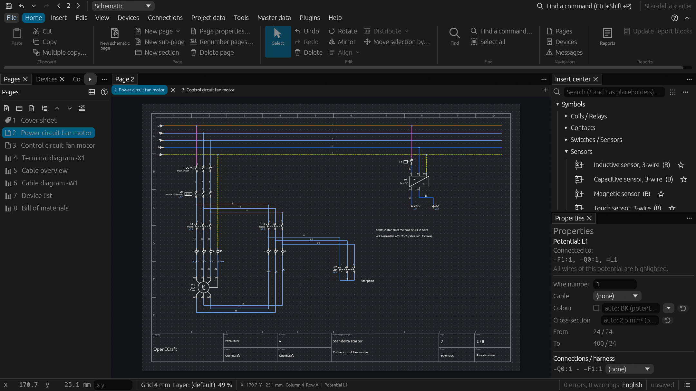
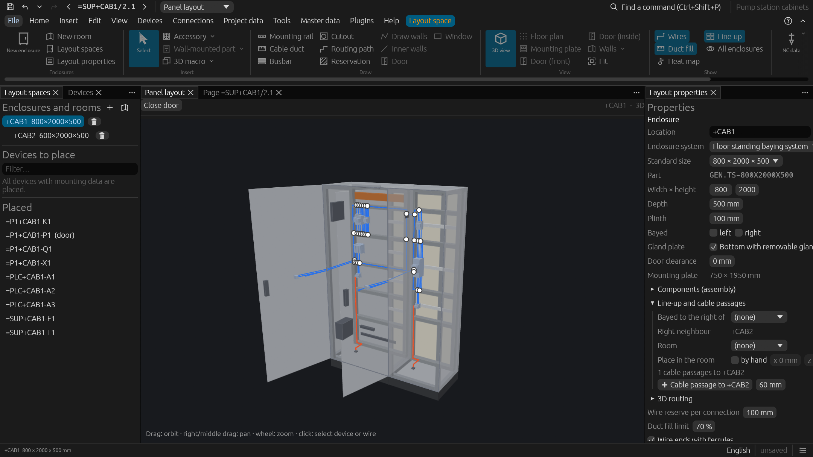
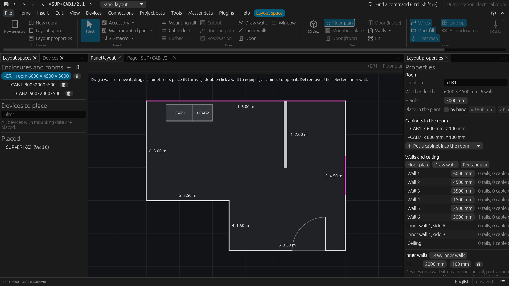
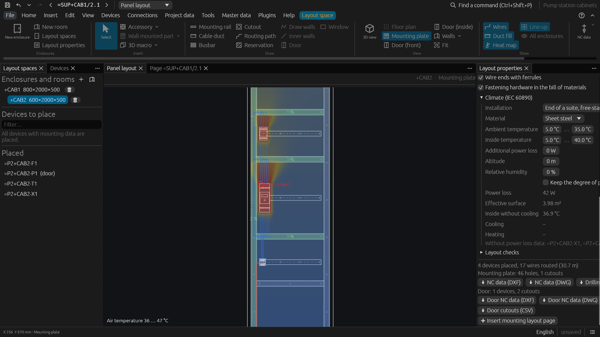
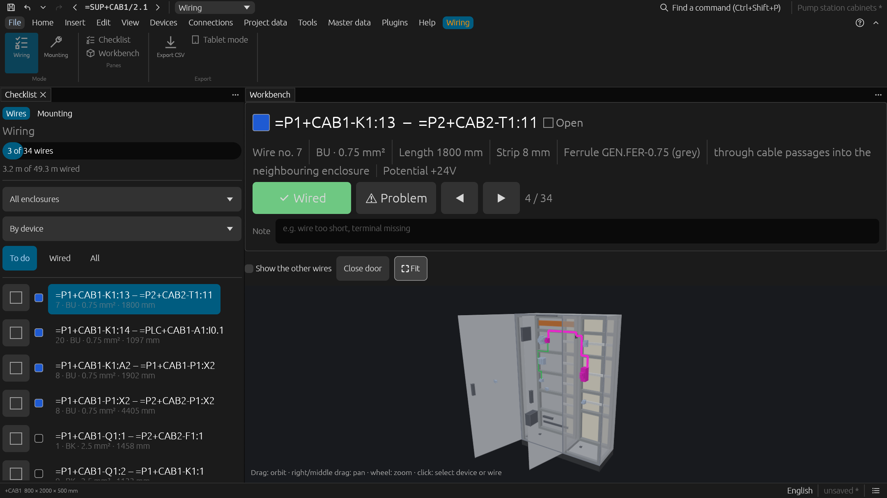
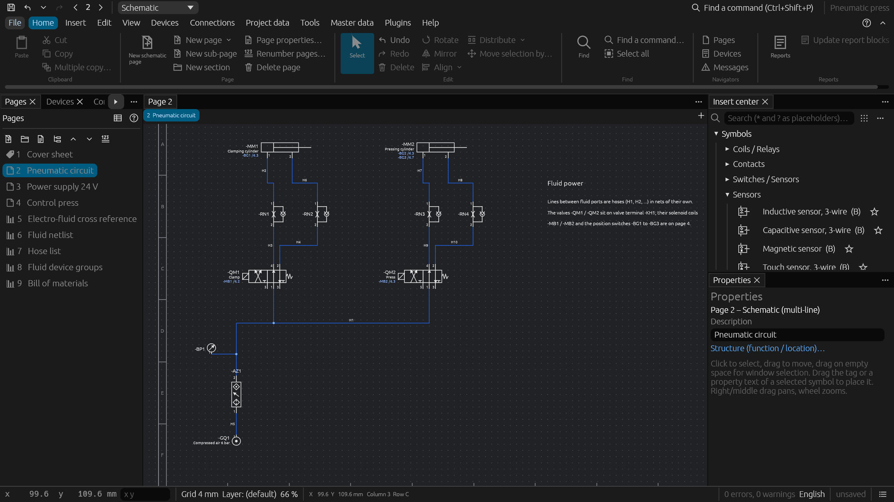
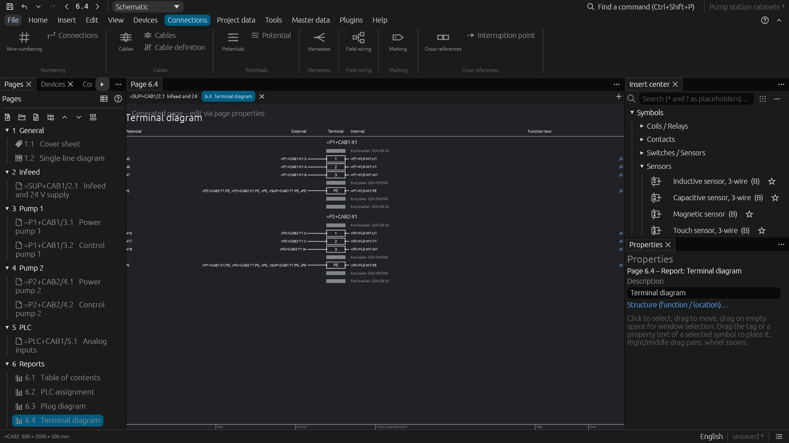

# OpenECraft

An open source electrical CAE editor written in Rust, in the spirit of EPLAN Electric P8.
One code base runs natively on **Windows, Linux and macOS** and in the **browser**
(WebAssembly), built with [egui / eframe](https://github.com/emilk/egui).



From the first schematic page to the panel in 3D, the wiring in the workshop and the
documentation for the customer – in one project file, with a command line and an MCP
server for scripts and AI agents.

New to OpenECraft? The [tutorial](docs/tutorial.md) walks from the first page to the bill
of materials, and the [example projects](#example-projects) show the features step by
step.

## Highlights

| | |
| --- | --- |
| **Device-oriented schematics** | Coils and contacts form one device with live cross references and contact images; structure identifiers (`=A1+CAB1-K1`), page sections, macros with variants, a configurator. [Schematic editor](docs/features/schematic.md) · [Macros and configurator](docs/features/macros.md) |
| **Symbol libraries** | About 330 IEC 60617 symbols, NFPA / JIC, GB, GOST and JIS sets, fluid power (ISO 1219), P&ID, installation plans, single-line; own symbols in the symbol editor. [Symbols](docs/features/symbols.md) |
| **Wires, cables, potentials** | Potentials with colours and cross-sections, cables with cores, automatic wire, device and page numbering. [Connections](docs/features/connections.md) |
| **Terminals, plugs, PLC** | Multi-level terminals with automatic accessories, plugs, PLC tag tables for TIA Portal, Studio 5000, TwinCAT, CODESYS and more, markers for the labeling software. [Terminals, plugs, PLC](docs/features/terminals-plugs-plc.md) |
| **Reports and checks** | Live report pages, graphical terminal / cable / plug diagrams, own drawn forms, a project check with message management. [Reports and checks](docs/features/reports-and-checks.md) |
| **Panel layout in 3D** | Devices at real size, virtual wiring with duct fill levels, drilling and NC data, enclosure climate with a heat map, line-ups, rooms and 3D routing. [Panel layout](docs/features/panel-layout.md) |
| **In the workshop** | Wiring and mounting assistants as touch-friendly checklists with the current wire in 3D – a tablet becomes a wiring station. [Assistants](docs/features/workshop.md) |
| **Engineering calculations** | Conductor sizing, short circuit and selectivity, load calculation, EMC, ISO 13849-1 safety functions, rule sets. [Calculations](docs/features/calculations.md) |
| **Harnesses, fluid, plant** | Wire harnesses with KBL and nailboards; hoses, valve terminals and PCT loops; pre-planning and single-line / multi-line engineering. [Harnesses](docs/features/harnesses.md) · [Fluid and process](docs/features/fluid-and-process.md) |
| **Revisions and review** | Released pages, approval workflow, baselines with compare and merge, comments, redlining and PDF comments. [Revisions and review](docs/features/revisions-and-review.md) |
| **Parts** | A parts database with mounting data and 3D models (STEP, IGES, Parasolid, JT, IFC), BMEcat, EPLAN XML and EDZ import, a shared data portal. [Parts](docs/features/parts.md) · [Parts server](docs/parts-server.md) |
| **Data exchange** | PDF, DXF / DWG, SVG; the panel as glTF, STEP, IGES, IFC, JT and Parasolid; ERP / PDM / PLM / ECAD / MCAD connectors, Autodesk Vault. [Output and data exchange](docs/features/data-exchange.md) |
| **Teams and automation** | Shared projects with page locks, roles and directory sign-in; a command line, an MCP server for AI agents and plugins in any language. [Project server](docs/project-server.md) · [Command line and MCP](docs/command-line.md) · [Plugins](docs/plugins.md) |
| **20 languages** | English, German, French, Spanish and 16 more, switched while the editor runs; project texts translated for documentation per language. [Languages](docs/features/schematic.md#languages) |

## A look inside

| | |
| --- | --- |
| [](docs/features/panel-layout.md)<br>**Panel layout in 3D** – two bayed enclosures with rails, ducts, busbars and door devices | [](docs/features/panel-layout.md#rooms)<br>**Rooms** – the floor plan of an L-shaped electrical room with inner wall, door, window and the line-up |
| [](docs/features/panel-layout.md#climate)<br>**Enclosure climate** – IEC/TR 60890 with a heat map of the mounting plate | [](docs/features/workshop.md)<br>**Wiring assistant** – the next wire highlighted in 3D, with its length and ferrule |
| [](docs/features/fluid-and-process.md)<br>**Fluid power** – valves, cylinders and their solenoid coils linked to the schematic | [](docs/features/reports-and-checks.md#forms)<br>**Graphical reports** – terminal strips with end brackets, end plates and the targets of every terminal |

## Example projects

The start page and *File › New* list ten example projects; each builds on the one
before and shows more of the features (command line: `list_examples`,
`new_project --example <name>`). All of them pass the project check without errors or
warnings.

| Level | Name | Shows |
| --- | --- | --- |
| 1 | `lamp_circuit` | One schematic page: +24V / 0V potentials, push buttons, selector switch, lamps, fuse, wire colours, parts and bill of materials |
| 2 | `self_holding_relay` | Relay with self-holding contact: coil and contacts as one device, cross references and contact image, terminal strip, page / column wire numbers, terminal diagram, connection list |
| 3 | `star_delta_starter` | Power and control circuit on separate pages: main switch, motor protection, three interlocked contactors, on-delay timer, interruption points, potential colours, 7-core motor cable with cable overview and diagram |
| 4 | `conveyor` | The demo project: PLC inputs and outputs, panel layout with rails, ducts and door devices, door harness |
| 5 | `pneumatic_press` | Electro-pneumatics: service unit, valve terminal, 5/2 valves, flow control valves and cylinders linked with solenoid coils and position switches; hose list, fluid netlist, electro-fluid cross reference |
| 6 | `pump_station` | Structure identifiers (`=SUP`, `=P1`, `=P2`, `=PLC`; `+CAB1`, `+FLD`), page sections, single-line diagram checked against the schematic, frequency converter, PLC cards with analog input, sensor plug, PLC assignment |
| 7 | `engineering_workflow` | The conveyor after revision A: locked pages, the change marked since, review comments and redlining, change request, revision B in the approval workflow, baseline |
| 8 | `cabinet_lineup` | The pump station in two bayed floor-standing enclosures (`+CAB1`, `+CAB2`): busbar system, rails and ducts, door devices and handles, filter fan and outlet filter, light, PE bar, gland plate with cable glands, cable passage, mounting layout pages, climate, duct fill, 3D routing list |
| 9 | `electrical_room` | The line-up in its room `+ER1`: L-shaped floor plan, inner wall, door and window, the line-up at its place, wall rail with a socket outlet, wall-mounted emergency light (part marked for wall mounting), cable tray under the ceiling |
| 10 | `pump_room` | The room of the line-up with its pumps: motors, pump and vessel standing on the floor (parts marked for floor mounting), ball valves and a gauge on the wall, a P&ID with DN25 water pipes routed in 3D along a pipe run, motor cables from the cabinets through glands in their roofs |

The projects are built in code (`crates/openecraft-core/src/sample/`), so they always
match the current file format; *Save as…* writes one as an `.oec` file.

## Getting started

Installers for Windows, Linux (deb, rpm, AppImage, Flatpak, snap, tar.gz) and macOS are
on the [releases page](https://github.com/nilres/OpenECraft/releases) and are built by CI
on every push; see [installation](docs/installation.md) and the
[changelog](CHANGELOG.md). From source, with a
recent stable Rust toolchain:

```bash
cargo run --release -p openecraft
```

```bash
cd openecraft && trunk serve
```

The second command serves the web version on http://127.0.0.1:8080 (it needs
`rustup target add wasm32-unknown-unknown` and `cargo install trunk --locked`).

## Documentation

| For | Pages |
| --- | --- |
| Users | [Tutorial](docs/tutorial.md) · [User interface](docs/user-interface.md) · [Installation](docs/installation.md) |
| Features | [Schematic editor](docs/features/schematic.md) · [Symbols](docs/features/symbols.md) · [Connections and numbering](docs/features/connections.md) · [Macros and configurator](docs/features/macros.md) · [Terminals, plugs, PLC](docs/features/terminals-plugs-plc.md) · [Reports and checks](docs/features/reports-and-checks.md) · [Revisions and review](docs/features/revisions-and-review.md) · [Parts](docs/features/parts.md) · [Panel layout](docs/features/panel-layout.md) · [Wiring and mounting assistants](docs/features/workshop.md) · [Calculations](docs/features/calculations.md) · [Harnesses](docs/features/harnesses.md) · [Fluid and process](docs/features/fluid-and-process.md) · [Output and data exchange](docs/features/data-exchange.md) |
| Administrators | [Parts server and parts manager](docs/parts-server.md) · [Project server](docs/project-server.md) · [Access control](docs/access-control.md) |
| Automation | [Command line and MCP server](docs/command-line.md) · [Plugins](docs/plugins.md) · [Harness interface](docs/harness-interface.md) |
| Developers | [AGENTS.md](AGENTS.md) (conventions) · [Architecture](docs/architecture.md) · [Code structure](docs/code-structure.md) · [Releasing](docs/releasing.md) |

Before a change is done, these must pass without warnings (CI runs them with
`-D warnings`):

```bash
cargo test --workspace
cargo clippy --workspace --all-targets
cargo clippy -p openecraft -p openecraft-parts-manager --target wasm32-unknown-unknown
```

## License

MIT ([LICENSE-MIT](LICENSE-MIT)) or Apache-2.0 ([LICENSE-APACHE](LICENSE-APACHE)), at
your option. The licenses of the libraries and fonts OpenECraft contains are listed in
`THIRD-PARTY-LICENSES.html`, which comes with every package.
