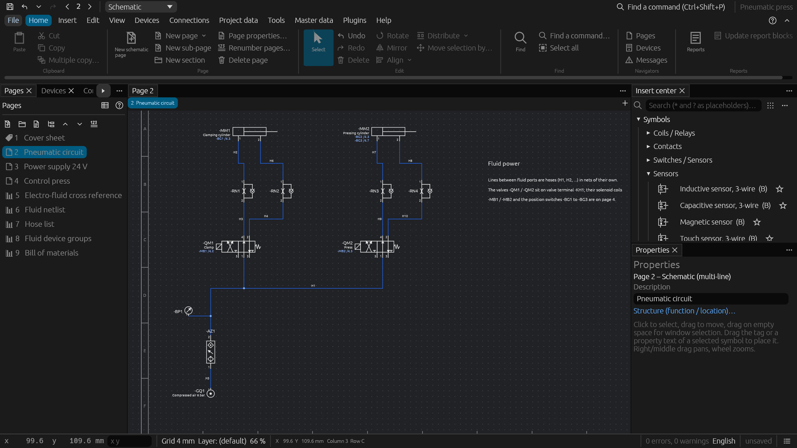

# Fluid power, process and plant engineering

Hoses and pipes in their own nets, electro-fluid links, PCT loops, the pre-planning of the plant and single-line / multi-line engineering.

## Fluid power

Wires between the ports of fluid power and P&ID symbols are hoses / pipes in their own
nets (not mixed with electrical potentials; a fluid port on an electrical net is an
error), numbered apart from the wires (`H1`, `H2` …), with medium, nominal size, colour
and length, listed in the *hose list*.

- *Fluid netlist*: every port gets its function from its ISO 1219 / ISO 5599
  designation (supply, pressure P/1, working A/B/2/4, exhaust R/S/3/5, return T,
  pilot X/Y/Z/12/14, leakage L, in-line) and every hose line its kind (pressure,
  working, return / exhaust, pilot … line) with its branches (tees).
- *Hose configuration*: per hose, tube or pipe the line type, part (by the metre),
  end fittings, maximum pressure and bend radius; the cut length adds the project's
  cutting allowance per end. Tubes between devices placed on the same mounting
  plate are routed through its ducts like wires, which gives the length when none
  is set. The *tubing / piping list* sums pieces, cut lengths, bends and fittings
  per type, size and part.
- *Fluid device groups*: valve terminals, service units, manifolds and power units
  with their devices in slot order and the number of places.
- *Electro-fluid*: fluid devices are linked with the electrical devices that actuate
  or monitor them (solenoid coils, position and pressure switches); both schematics
  show cross references to each other, and *Synchronize* links solenoid valves with
  the coil of the same number (`-QM3` → `-MB3`) and copies function texts.
- Checks: pressure lines on a return / exhaust, different media or sizes on one hose
  or one device, hoses rated below the operating pressure or shorter than their
  route, solenoid valves without coil, coils without valve, wrong or missing links,
  full or duplicated groups; open exhausts of pneumatic devices vent to the
  atmosphere instead of being open connection points.
- Reports: *fluid netlist*, *hose configuration*, *tubing / piping list*, *fluid
  device groups*, *electro-fluid cross reference*.

## Process (P&ID)

P&ID symbols (ISO 10628: vessel, pumps, valves, heat exchanger, instruments) support
pre-planning: instruments carry function letters and loop number (`TIC 101`), the
PCT loops of the pre-planning (*Tools › Fluid and process…*) list their devices,
and the *PCT loop overview* shows whether each loop is planned, in engineering or
engineered in the schematic.

## Pre-planning

**Pre-planning** (*Devices › Pre-planning…*): the plant as a tree of segments
(plant, area, unit, …) with function and location inherited down the tree and the
devices planned in them (tag, kind, description, power, voltage, part, page macro);
the planned power per segment, segment templates, the state of every planned device
against the schematic (planned, engineered, part differs; also a check and the
report *Pre-planning*), schematic pages generated from the page macros of the
devices not engineered yet, and the exchange as CSV / Excel (commands
`preplanning`, `add_segment`, `plan_device`, …; tools `import_preplanning`,
`generate_preplanning_pages`).

## Single-line / multi-line engineering

**Single-line / multi-line engineering** (*Devices › Single-line / multi-line…*):
devices are planned with single-line symbols (breaker, switch-disconnector, motor
protection switch, fuse, overload relay, contactor, motor, transformer) on overview
pages and engineered in the multi-line schematic; both share the device tag. The
window lists each device as planned, engineered, not in the single-line diagram or
not matching, and generates the schematic of a single-line page (3-pole power
symbols, conductors, contactor coils) or a single-line diagram of the schematic's
power devices (arranged from the supply to the loads). The check reports planned
devices, mismatching symbols, connections of the single-line diagram missing in the
schematic and differing function texts; *Synchronize function texts* fills empty
ones from the other representation.
