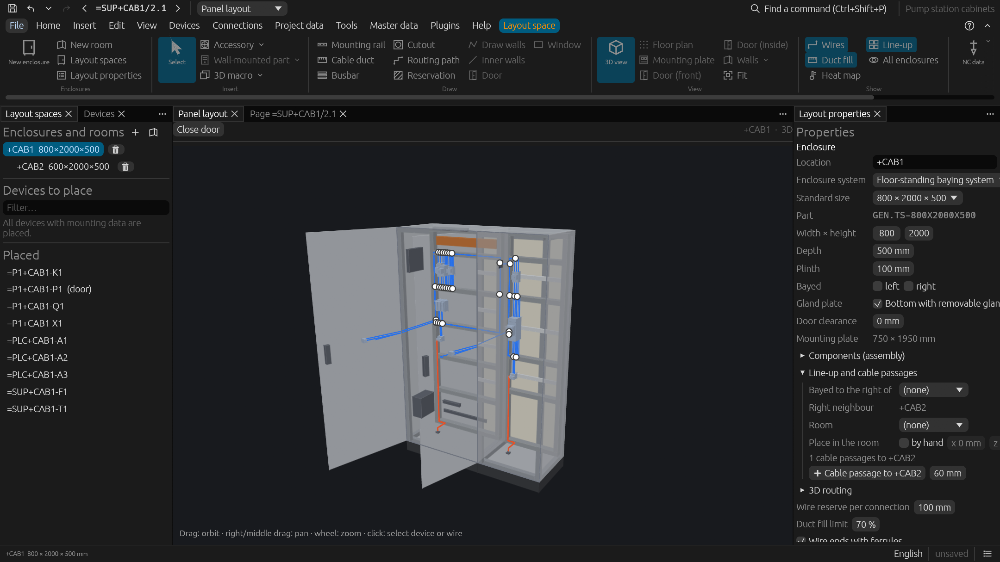
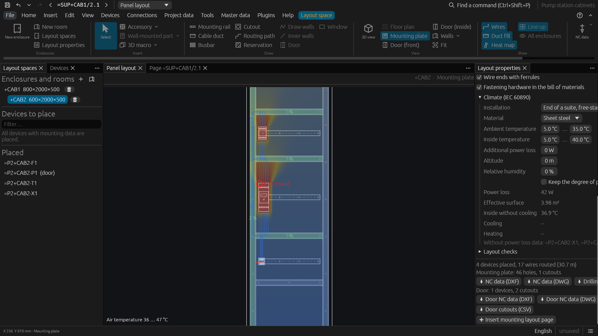
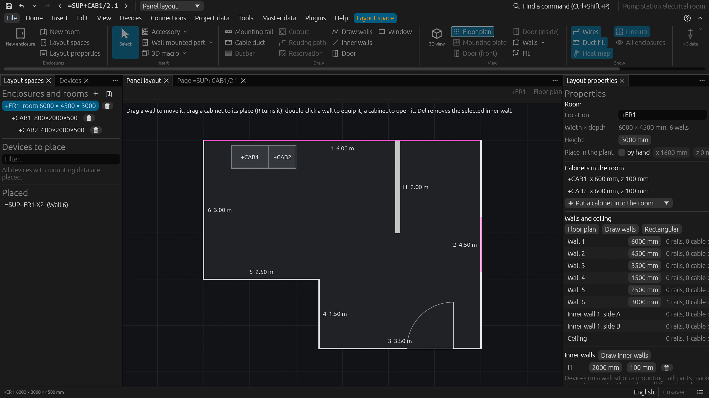

# Panel layout, rooms and 3D routing

Enclosures with their devices at real size in 2D and 3D (in the spirit of EPLAN Pro
Panel), virtual wiring through the ducts, drilling and NC data, enclosure climate,
line-ups, rooms of the building with their floor-standing equipment and pipe runs,
and 3D routing of cables, tubes and pipes. The example projects `conveyor`,
`cabinet_lineup`, `electrical_room` and `pump_room` show them.

## Enclosures and devices

- Enclosures (from a part such as `GEN.ENC-600X800` or custom size) with mounting plate.
- Mounting rails and cable ducts drawn by length; devices placed from a "devices to
  place" list with their real dimensions from the parts data (contactor + auxiliary
  block add up in depth, terminal strips are as long as their terminals and spares) and
  snapped onto rails; move (devices travel with their rail), rotate, delete.
- 2D front view and a 3D view (orbit, pan, zoom, click to select).
- Copper **busbar systems** (bars drawn, metres and holders in the BOM) and rectangular
  or round **cutouts** in the mounting plate.
- Mounting layout pages (scaled 2D model view with dimensions) for printing / SVG;
  rails and ducts appear in the BOM by cut length, enclosures per piece.
- Jump between a device in the schematic and its place in the panel layout.

## Collision and boundary checks

Overlaps, outside the plate, too deep for the enclosure including a door clearance,
mounted over a cutout, inside the clearance a device needs above and below from its part
data (`Clearance: 25 mm`); where a device has a 3D model, the **models** are checked for
penetration, not just their boxes.

## Enclosure door

Command and signal devices (pushbuttons, lamps …) are placed on the door (front view
*Door*); each gets its **door cutout** (Ø22.5 by default or from the part data
`Door cutout: Ø30.5` / `92 x 68`), checked against the door frame and in 3D against the
equipment of the mounting plate; their wires are routed over the hinge; the mounting
layout page shows the plate and every face with items (door, side walls, rear wall,
roof, bottom) side by side.

## Drilling pattern and NC data

Rails, ducts and busbar holders get tapped holes along their length, devices screwed
onto the plate get holes from their part data (`Mounting holes: M5: 9,12; 69,72`) or two
default holes; **NC export** per enclosure and face as DXF or DWG (outline, one layer
per hole diameter, cutouts) or CSV.

## Virtual wiring and duct fill levels

Every schematic connection between placed devices is routed from its connection point
(rotated devices, aux blocks, terminal by terminal) into the duct the terminal faces and
through the cable duct network (shortest path) → wire list with lengths, wires shown in
2D / 3D.

**Duct fill levels**: cross sections of the routed wires (with insulation) against the
duct cross section at its fullest stretch; ducts coloured green / orange / red in the
front view, fill level in the duct properties, limit in the enclosure properties (70 %
by default); report *Duct fill levels*, the check warns above the limit and hints above
80 % of it; when a duct is overfull, the wiring is routed again, thickest wires first,
and wires take a detour (up to 10 × longer) around stretches they would fill above the
limit; the selected device shows its connection points.

## Climate

IEC/TR 60890, in the enclosure properties: power loss of the placed devices from the
tech data of their parts (`Power loss: 7.5 W`) plus an additional loss, effective
surface by installation type (single, in a suite, free-standing, wall mounted, roof
covered), material (heat transfer coefficient), ambient and allowed inside temperatures
→ inside temperature, filter fan air flow (corrected for the altitude of the site),
air/air heat exchanger (W/K, when the degree of protection must be kept) or cooling unit
output, heater output that also keeps the inside above the dew point of the ambient air
(relative humidity); report *Enclosure climate*, the check warns when cooling is needed.

The heat map of the mounting plate stratifies the mean temperature and adds a plume
above every device with power loss data; horizontal ducts hold plumes back (warm air
gathers below them), fans and cooling units weaken them.

## Line-ups

Enclosures bayed side by side with cable passages between them (cutouts in the facing
side walls, or sides open to each other); the 3D view shows the whole line-up, wires run
from one enclosure into the next. The *room* view shows all enclosures side by side at
their places, each line-up at its position and turn set by hand or taken from the plant
layout.

## Rooms

*Layout space › New room* (plugin `rooms`): a room of the building with its floor plan,
height and place in the plant. The floor plan is a rectangle or an outline of walls at
right angles (L, U or T shaped rooms): *Floor plan* shows it from above, *Draw walls*
draws it by clicking the corners (on a 50 mm grid, closed by clicking the first corner
or Enter), walls are dragged to move them or get a length in the room's properties
(commands `set_room_outline`, `set_room_wall`).

- **Inner walls** (*Layout space › Draw › Inner walls*, commands `add_inner_wall`,
  `set_inner_wall`) are drawn in the floor plan by clicking their ends (a chain, at
  right angles; an end near a wall snaps onto it), dragged across to move them, get
  length and thickness in the room's properties and are removed with Del; both sides (`inner1a`, `inner1b`) are faces like
  the walls.
- **Doors and windows** (*Layout space › Draw › Door / Window*, command
  `add_wall_opening`) are openings in a wall, placed by clicking the wall in the floor
  plan or in the view of the wall: a door stands on the floor and swings into the room
  (drawn with its swing), a window has its sill height; size, position and sill are in
  their properties.
- **Cabinets** (their line-ups) stand in it at a place of the floor plan, dragged there
  in the floor plan (R turns the selected one about its centre), and move with the
  room. A cabinet outside the room, across a wall, in an inner wall or in the swing
  of a door is drawn in the warning colour, and the pointer over it tells why.
- Every wall (seen from inside the room) and the ceiling carry mounting rails, cable
  ducts and devices: a device on a wall sits on a rail, unless its part is marked
  *Wall mounting* (part editor › Mounting data, a `WALL` badge in the part trees, filter
  *Only parts for direct wall mounting*), then it goes directly on the wall
  (*Insert › Wall-mounted part*, also without a device tag).
- The **floor** (face `floor`) carries the parts marked *Floor mounting* (pumps, tanks,
  compressors; a `FLOOR` badge, filter *Only floor-standing parts*): *Insert ›
  Floor-standing part*, devices to place on the floor's view, command `mount_on_wall`
  with `face` `floor`. They are drawn in the floor plan, dragged there to move them and
  removed with Del.
- **Pipe runs** (*Layout space › Draw › Pipe run*, command `add_pipe_run`) are drawn on a
  wall, the ceiling or the floor by clicking their corners (at right angles), 100 mm in
  front of a wall, 300 mm below the ceiling or 200 mm above the floor unless set
  otherwise: the hoses, tubes and pipes of the schematic are routed along them like
  wires along cable ducts. The floor plan shows them dashed.

The check reports devices on a wall that are neither, rails or devices over a door or
window, pipe runs across a door or window, items on the ceiling outside the floor plan,
inner walls leaving the room, cabinets and floor-standing parts in the swing of a door
or in an inner wall, floor-standing parts on the place of a cabinet or not made to
stand on the floor, and cabinets and floor-standing parts outside the room (or across a
wall), cabinets higher than its ceiling. Rooms have no climate calculation and no NC
data.

## 3D routing

Cables, tubes and (optionally) wires are routed through the line-up: in cable ducts,
along routing paths drawn over the mounting plate, or freely around the devices;
segregation of the classes power, control, signal and fluid, routing reservations, bend
radii, cable bundles with their branches, shield terminations (shield clamp rail,
pigtail) and their checks; routes can be frozen for production and stay as they are
until they become invalid.

In a room, routes run through its free space: around its walls, inner walls, the
cabinets standing in it and the swing of its doors, preferring its cable ducts and pipe
runs. A route between a cabinet and a device in its room (or two cabinets of one room)
runs in legs: through the cabinet to a cable gland on its roof, sides or rear (one of
its own cabinet first, otherwise of the line-up; without one through the middle of the
roof, which is reported), then through the room. Frozen, such a route keeps its legs.
The example `pump_room` shows floor-standing pumps, a pipe run and the routes.

The routed panel is the input of the [wiring and mounting assistants](workshop.md) and of
the 3D exports (glTF, STEP, IGES, IFC, JT, Parasolid; see
[output and data exchange](data-exchange.md)).
